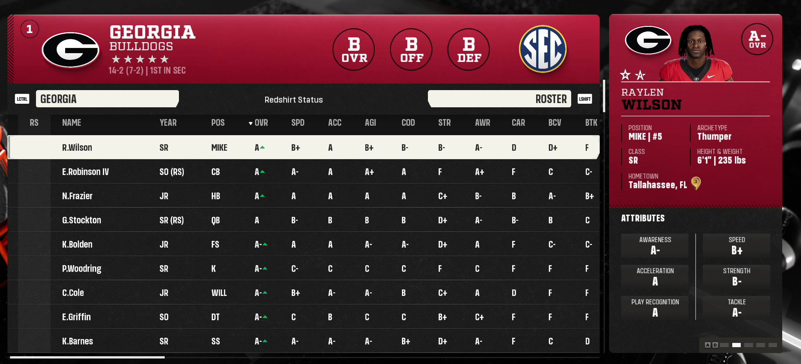
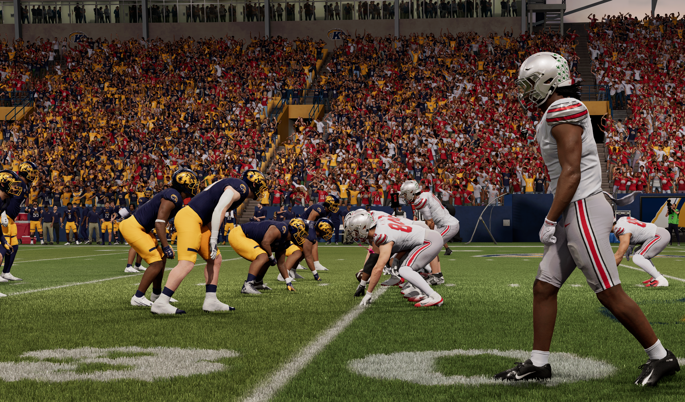
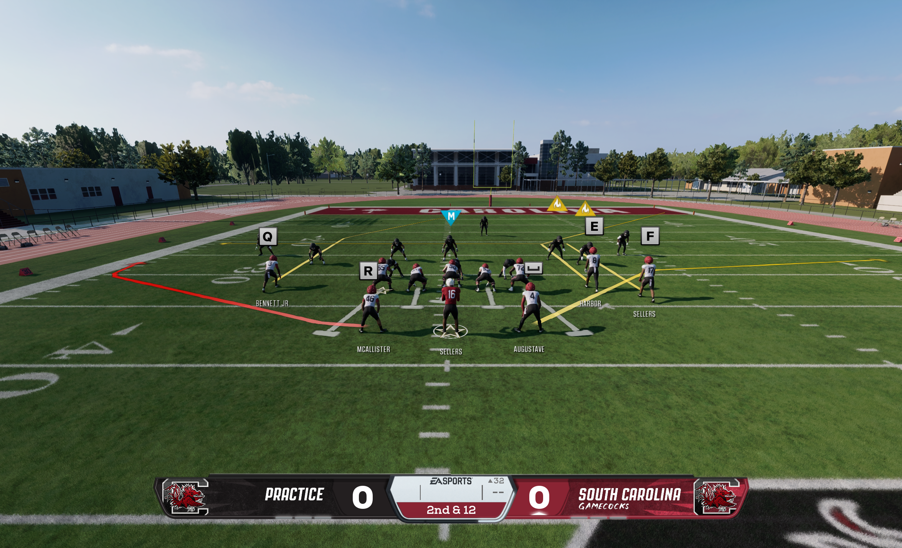
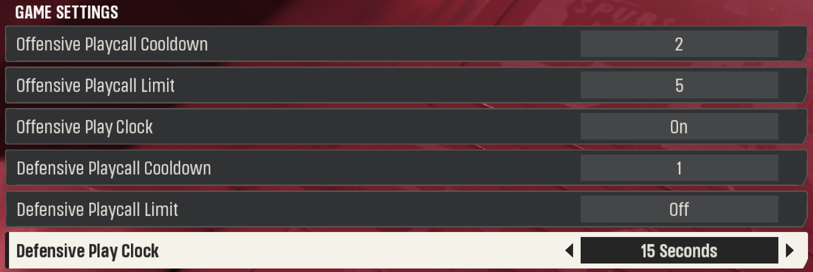

# Dynasty COT by Ace

Dynasty COT is the collection hub and optional installer for four independent College Football 27 modules. Development and shared compatibility checks stay in this workspace. Each standalone repository is its module's download and support page.

**Want one feature? Download its standalone ZIP. Want several? Use the Dynasty COT installer.**

| Module | Standalone download | Current version |
|---|---|---|
| Beyond the Field | [ZIP and release notes](https://github.com/ArtVsTheWorld/BeyondTheField/releases) | 1.0.7 |
| Gameday Atmosphere | [ZIP and release notes](https://github.com/ArtVsTheWorld/DynamicGamedayAtmosphere/releases) | 2.1.11 |
| Extra Settings | [ZIP and release notes](https://github.com/ArtVsTheWorld/offline-dynasty-settings/releases) | 0.2.10 |
| Expanded Practice | [ZIP and release notes](https://github.com/ArtVsTheWorld/drive-based-practice/releases) | 0.8.21 |

**Collection installer:** the new **1.1.0-rc1** installer is in private testing; it is not yet a public download. [How the collection installer works](docs/collection-installer.md). It installs the exact standalone DLLs you choose, without a separate DynastyCOT.dll. The [older 1.0.x bundle releases](https://github.com/ArtVsTheWorld/DynastyCOT/releases) remain available for existing users and rollback; they use the previous host design.

## Beyond the Field

- **A livelier Social Media feed:** results, rankings, recruiting, awards and more, with reporters, team accounts, players and fans. Browse For You, National, conference, team and topic filters, or return to past editions. National shows up to 300 cards; extra wording choices add variety without increasing the weekly post budget.
- **More uncertainty when building your team:** separate recruiting, roster and team fog options let you see less exact information. Recruiting Notes keep a recruit's developing profile together.
- **Recruit interest choices:** Default keeps the normal game display. Recruit Feedback replaces exact bars/ranks with broad standings; Rank Only hides the bars. Previously scouted, off-board and uncommitted prospects get a scouting-progress icon.
- **Choose how ratings look:** use letter grades, descriptive words such as GOOD, or the other included scales. Rating colors are optional. Compact money labels turn long amounts into readable $K/$M values.
- **Player Analytics:** browse a selected team's weekly and season performance grades, snaps and player cards. Gridiron Performance Index (GPI) provides mod-calculated grades from available Dynasty statistics. Only completed weeks contribute. National Analytics and the Player Stats shortcut are not included.

Beyond the Field fog, rating styles, colors and money formatting apply inside Dynasty; main-menu and Play Now displays stay native. Find the options under **Beyond the Field** in Dynasty settings. Social Media and fog start on; rating colors and dollar formatting start off. Published posts, accounts and history survive updates.

## Gameday Atmosphere

- **Crowds with a reason to be there:** attendance considers the program, results, opponent, venue and supported game context. Fans arrive, take breaks and leave as the game develops.
- **Traveling supporters:** recognizable visiting sections and small groups use fanbase demand, distance and matchup appeal. Strong home support resists takeovers. Winning visitors can still leave early, more slowly than a badly beaten home crowd.
- **More reactive sound and shake:** crowd energy builds before plays and reacts to important moments. Crowd fullness and the score affect background noise; stronger reactions take priority. Shake requests an accompanying crowd sound.
- **Your choice of atmosphere:** in-game controls cover attendance, sound, shake and replay options. Visiting Fan Strength starts at **100%**; lower or raise it to influence newly generated visiting-crowd plans. Saved plans and history stay intact.

Bands and verified military crowd groups retain their protection. Neutral-site crowd appearance stays native. Find the module under **User Settings > Gameday Atmosphere**.

The **basic offline Play Now** path adds crowd reactions, sound, shake and departures. With arrivals enabled, fresh games start at 75% of the available crowd, then fans continue arriving. Visiting-fan appearance stays native; Dynasty travel, season plans and saved crowd history are not used. Added replay changes skip touchdowns so the game controls their presentation. Additional Replays remains available for other eligible plays. Ace installed the final build, restarted MMC and the game, and reported the fixes working.

## Expanded Practice

- Keep normal practice, run full drives, or play a scrimmage with possession changes.
- Start from a chosen spot, switch sides and check session statistics.
- Drive modes track downs, field position and scores through the normal practice screen. Default Practice remains available.

Enter offline Dynasty practice or main-menu Practice and use the pause-menu Mode control.

## Extra Settings

- Set offensive and defensive playcall cooldowns and limits.
- Choose offensive and defensive play clocks independently, including extra durations and Off options.
- Each Dynasty keeps its own choices. New Dynasties start with offensive clock **On**, defensive clock **15 seconds**, and playcall restrictions off.

Open **Dynasty > League Settings > Game Settings**. Start a new game after changing gameplay settings.

## Install or update

**Drag and drop:** close the game and MMC Mod Manager. Download a module's ZIP and put its DLL directly in your versioned Mod Manager's Plugins folder. Each ZIP includes a short README and full feature list. Matching support files are embedded. Move older duplicate DLLs outside Plugins; keep their settings/history folders.

**Collection installer (new private candidate):**

1. Open setup. It tries to find MMC automatically. If needed, choose **Find exe** and select **MMCModManager.exe** inside the versioned Mod Manager folder.
2. Check the modules you want, then choose **Install / Update**. It downloads only selected modules that need changing. Unchecked modules stay installed as they are; **Remove** provides selected/full removal.
3. Restart MMC and launch normally. The installed files are the same standalone DLLs available above.

**Updates stay optional and independent.** Choose **Check for updates**, read each module's notes, choose versions and then use Install / Update. Checking alone downloads no module ZIPs. Keeping an older version is allowed. An atmosphere-only update does not download Beyond the Field again.

**Backups** restores prior plugin versions. A one-time migration from older COT backs up its host and matching program files before replacing it with standalones. Keep every enabled old-COT module selected during that conversion, or explicitly remove an unwanted module first. Unknown plugin copies require review of their exact paths/hashes. Settings, accounts and published history stay in place.

Use a writable Mod Manager folder, preferably outside Program Files: the modules need to prepare their support files and save settings/history. Setup reports permissions and real running-process errors without changing Windows permissions. [Migration, logs, rollback and private-test checklist](docs/collection-installer.md).

## Compatibility and data

Beyond the Field and Extra Settings target offline Dynasty. Expanded Practice also supports offline main-menu Practice, and Gameday Atmosphere has a basic offline Play Now path. AIO 1.4.1 and its TeamBuilder patch have targeted adapters; compatibility with every overhaul/version is not guaranteed. Unknown native programs remain rejected. See the [regression checklist](LIVE-ACCEPTANCE.md).

The module DLLs now use the new branding. Older internal IDs and data-folder names remain intentionally unchanged so existing settings, published history and crowd plans keep working. New collection installs place the four selected standalone DLLs in Plugins; they do not install DynastyCOT.dll. Native runtime DLLs stay outside MMC's plugin scan. Logs stay inside module folders. Extra Settings and Expanded Practice retain their verified runtime helpers.

## Build and contribute

The lightweight collection installer builds from its source, catalog and app icon without an MMC SDK. See the [collection build steps](docs/collection-installer.md#build-and-maintain). Building the standalone game modules still uses the [source build and release guide](docs/release/README.md) and requires Windows, a compatible local MMC SDK, MSVC, PowerShell, Python and Node, plus private, legally obtained native research inputs. SDKs, saves, histories and private research are excluded from this repository. A public checkout alone cannot run every native verification step.

Imported-source records are under `Baselines`; compatibility contracts are under `Compatibility`. Required third-party notices remain included. Automated verification is separate from live-game acceptance.
