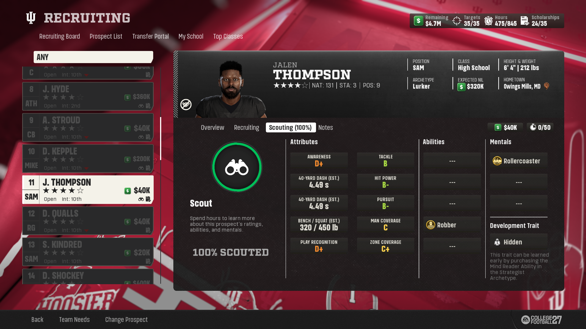

# Ace’s Beyond the Field

## Follow a week in your Dynasty

From the offline Dynasty hub, open **Team > Social Media**. The feed puts your program's week alongside stories from its conference and the rest of the country. Open **Dynasty Settings** and find the **Beyond the Field** section to choose what appears. New Dynasties start with **Social Media Feed** on.

| To follow | Choose |
| --- | --- |
| Your program and nearby storylines | **For You** blends your team, conference and national news. |
| A conference or a single school | Select its name in the feed. A team view can surface stories that miss the national selection. |
| The wider season | **National** shows up to 300 cards. Filter by topic to narrow the edition. |
| A week you remember | Choose an earlier published edition. Replies travel with the post they answer. |

### Read the voices behind the stories

A school account can announce a signing, a beat reporter can cover the class and fans can argue over what it means. Players and recruits have their own accounts. Rankings, injuries, awards, transfers, coaching changes and game results appear when there are facts to report. A recruit's signing follows the school he actually joined, even if his interest list still shows a different leader.

> Reloading a published edition keeps its words and account identities. A quieter team week may have fewer posts. A recovered competitive week needs recorded game results, and missing private recruiting activity cannot be reconstructed from a score.

## Choose what the ratings reveal

In **Dynasty Settings > Beyond the Field**, pick separate scales for **Recruiting Fog**, **Roster Fog** and **Team Fog**. All three start at **A+-**. Recruiting covers prospects, roster covers your players, and team covers Overall, Offense and Defense. These choices change what supported screens show. The players keep their underlying abilities.

| Choice | How to read a revealed 87 rating |
| --- | --- |
| Off | The supported screen can show its normal number, 87. |
| A+- (default) | B+. Plus and minus split each passing letter band into smaller groups. |
| A | B. This scale uses one letter per ten points from 60 through 99, with A at 90 and above. |
| S | B. A rating of 95 or above earns S. |
| Descriptive | Great. The five bands are Elite, Great, Good, Fair and Poor. |
| Blind | A dash conceals the rating. Recruiting Blind also conceals the recruit's interest clues. |

**Rating Colors** starts off. Turn it on if colors help you recognize grades at a glance. **Dollar Values** also starts off. Turn it on for short money labels such as $40K or $2M on supported budget and recruiting screens. Editing a value still changes the actual amount.

> Try **Recruiting Fog = Descriptive**, **Roster Fog = Off** and **Team Fog = Blind**. Scouting reads like a report, your roster keeps numbers, and team badges hide matchup ratings.

## Scout a prospect

Open a prospect in **Recruiting** and visit **Notes**. Read the football observations alongside scouting progress. New reports take your school's pipeline relationship into account. A strong pipeline can improve information, but an observation is still an assessment. A previously scouted, uncommitted player can retain a scouting icon after leaving your board.

### Where the background comes from

A supported new high-school prospect gets a fictional previous season built around position, role and workload. An athlete who plays two roles can have a second role that fits the first. Academic GPA is background information. Active portal players receive football observations. A short transfer label such as **TR RSFR** identifies a redshirt freshman transfer.

## Read a scouting card

### Choose the clues on the recruiting screen

**Measurables Display** starts at **Default**. Choose **Athletic Measurables** to see estimates for revealed physical traits, including dash, lifts, cone, shuttle and vertical results. Scouts still need evidence to uncover them. The same prospect keeps a consistent estimate on reload.

**Interest Display** starts at **Default**, the game's usual bars. **Recruit Feedback** groups schools into broader standings. **Rank Only** keeps rank and hides the bars. You can use these displays with Recruiting Fog off. **Blind** conceals interest, ranks, cutoff clues and measurements. Notes can still contain observations you have earned.

> A workout estimate describes a prospect before he reaches your roster. A player who tests well can still struggle in games. Keep existing Notes when updating: the presentation can improve without rerolling a prospect's past.

## See what happened on the field

Open **Stats & Records > Player Analytics** in the supported Dynasty layout. Select a team, then a completed week or **Season**. Read a player's GPI performance grade alongside snaps and open a full player card for more context. These grades estimate performance from tracked game statistics for the position.

| Question | Where to look |
| --- | --- |
| How did a player do last week? | Choose the completed week. Week 0 becomes available in Week 1. |
| How has the season gone so far? | Choose Season. Unfinished weeks stay out. With one graded game, the weekly and season grades match. |
| Who else noticed the game? | Look for qualifying @GPIndex posts in Social Media. Every player does not receive a post. |

### Check the screen you're using

Fog also reaches supported depth charts, player cards, hub comparisons and Dynasty Extensions reports and drill selectors. Roster editing and unsupported presentation screens can have different rules. Main-menu and Play Now ratings keep the game's own presentation. Supported spring exhibitions stay separate from competitive results.

### More than one coach

The verified view is the Dynasty owner's school. Public editions can be recovered when enough facts exist. Choosing a different coach as the active school and keeping Notes private to each coach still have limits. If you share a league, check whose school a screen shows before relying on a report.

> Installed-menu checks remain open for Notes, transfer-label fit, grade displays and returning from a full player card. When reporting a mismatch, name the exact screen and the three fog settings.

## Getting help

### 1. Tell us what happened

Write **Ace’s Beyond the Field 1.0.24**, the game mode and what you tried. Say what you expected and what happened instead.

### 2. Show the screen

Take a screenshot of the full scouting card or the post that looks wrong, with the school and week visible if possible.

### 3. Send the matching log

Press **Win+R**, paste **%LOCALAPPDATA%\Ace\DynastyCOT\BeyondTheField** and press **Enter**. For startup, open **Logs** and attach **BeyondTheField-launcher.log**. For a feed problem, also attach **runtime-generator.log** or **social-media.jsonl**. For a scouting problem, attach **recruiting-fog.jsonl** if it was created.

> If the folder or log is missing, say which one you could not find. Send the screenshot anyway.
