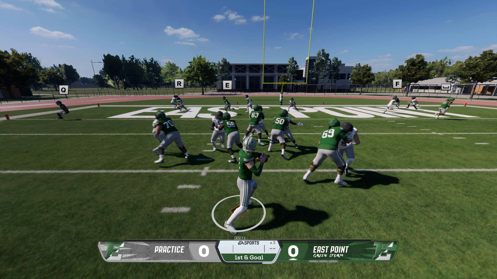

# Ace’s Expanded Practice

## Make practice feel like a drive

Enter **Practice** from an offline Dynasty or use the supported main-menu Practice route. Every session opens in **Default Practice**. Pause, highlight **Mode** and cycle to the practice you want. The first snap counts immediately.

| Mode | What happens after each play |
| --- | --- |
| Default Practice | The game resets the ball to its usual spot. Choose the plays for both sides and repeat a rep. |
| Drive Practice | The ball moves, the downs count and a yellow line marks the next first down. Choose one side's play while the CPU chooses the other. When the drive ends, start again from your chosen spot. |
| Scrimmage | Play a series of possessions. Scores, turnovers and fourth-down stops can send the other unit onto offense. The CPU calls the other side's play. |

### From one rep to a series

Say you want to practice converting third downs. Rehearse one call in Default Practice. Switch to Drive Practice and try to earn a first down through a series of snaps. Switch to Scrimmage when you want a turnover to change which side has the ball.

If both sides have already picked a play when you switch into a drive mode, those calls can carry into the first snap. Use **Choose New Play** from the pause menu to make a different call first.

> **Before switching modes:** check the scoreboard or open **Stats** if you want to keep a note of your results. Every mode change starts a fresh session and clears its totals.

## Play the field position

### Set up another series

**Re-spot Ball** starts a fresh first down at your selected spot. The distance is normally ten yards, or the distance to the goal near the end zone. **Flip Sides** starts a new drive with you controlling the other side. Both actions keep the current session's score and totals. To reset the totals too, switch modes.

| Result | Drive Practice scoring |
| --- | --- |
| Offensive touchdown | 6 points for the offense. |
| Interception or recovered fumble | 4 points for the defense if it takes possession without a return touchdown. |
| Fourth-down stop | 2 points for the defense. |
| Defensive return touchdown | 6 points total for the defense. |

## Practice near the goal line

### See the end of the return

In Scrimmage, play the return through the whistle. An interception or fourth-down stop changes possession without bonus points. A touchdown scores six and a safety scores two. After a score, the next possession starts at the 25. After an ordinary turnover, the spot follows the result of the play.

> Intercept a pass and get tackled. Drive Practice awards four defensive points and prepares another drive. In Scrimmage, the intercepting team gets the ball where the return ended. Return the pick for a touchdown and the defense scores six.

## Read your session

Open **Pause > Stats** in either drive mode. The rows show both teams. Net offensive yards measures how far each unit moved the ball, so a sack can take yards off that total. First downs help distinguish a string of short gains that moves the chains from one that leaves you short on fourth down.

| Look at | What you can learn |
| --- | --- |
| Practice plays, net offensive yards, first downs | How many reps each offense had and how often it moved the chains. |
| Offensive touchdowns | How often each offense finished a series. |
| Interceptions, fumble recoveries, stops on downs | Which changes of possession came from the defense taking the ball and which came from a failed fourth down. |
| Defensive touchdowns, defensive points, safeties | How stops and scores affected this session under the mode you chose. |

### Know which controls apply

Drive modes cover run and pass practice. They have no game clock or kicking sequence. The statistics belong to this session. When you want normal two-sided play selection or repeated snaps from one spot again, cycle **Mode** back to **Default Practice**.

Expanded Practice works on its own. With Dynasty Extensions present, the supported pregame controller screen has a compatibility check. Extensions layouts can change between releases. Check Dynasty practice and main-menu Practice separately after updating either mod. The installed menu and exact combination still need a live session to verify.

## Getting help

### 1. Tell us what happened

Write **Ace’s Expanded Practice 0.8.24**, the game mode and what you tried. Say what you expected and what happened instead.

### 2. Show the screen

Take a screenshot of the pause menu showing Mode, or the scoreboard showing the score, down and distance that looked wrong.

### 3. Send the matching log

Press **Win+R**, paste **%LOCALAPPDATA%\Ace\DynastyCOT\ExpandedPractice** and press **Enter**. Attach **latest-report.zip** if it is there. If it is missing, send **launcher.log** and **SituationalPractice.log** from the same folder. Say whether you entered practice from Dynasty or the main menu.

> If the folder or log is missing, say which one you could not find. Send the screenshot anyway.
