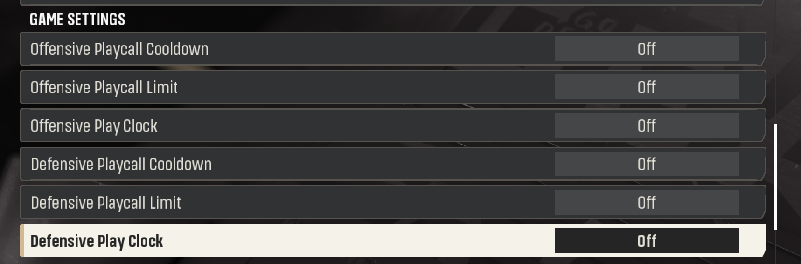

# Ace’s Extra Settings

## Choose the pace of a game

Load your offline Dynasty and open **League Settings > Game Settings**. Look above Clock Management for six rows. Two set the time each side has to choose or run a play. Four control how often you can call the same play. Start a new game after making changes.

### Set the offensive play clock

| Choice | What you'll see on offense |
| --- | --- |
| On (default) | The ordinary countdown runs. Use this when you want the game's usual time pressure. |
| Off At Playcall | The countdown pauses while you choose a play. Once you leave play selection, the clock can run again. |
| Off | The offensive countdown and its delay-of-game penalties are disabled. |
| 60 Seconds | The extended countdown gives you 60 seconds. |

## Find all six game settings

### Give the defense its own clock

Choose **3, 5, 15, 20, 30, 45 or 60 Seconds**, or **Off**. A new Dynasty starts at **15 Seconds**. This choice controls defensive play selection. You can give yourself time to browse the offensive playbook and still ask the defense to decide quickly.

> To learn a new playbook, try **Off At Playcall** on offense and **30 Seconds** on defense. On offense, take your time comparing routes. At the line, pay attention to the countdown again.

## Encourage a wider playbook

A **cooldown** sets the number of plays that must pass before you call the same play again. A **limit** sets the maximum number of times you can call it in one game. Each side gets its own pair of controls. A value of **0** turns off that one restriction. Fresh settings start with all four off.

| Game Settings row | Available values |
| --- | --- |
| Offensive Playcall Cooldown | 0 to 10 plays between uses. |
| Offensive Playcall Limit | 0 to 20 uses of each play per game. |
| Defensive Playcall Cooldown | 0 to 10 plays between uses. |
| Defensive Playcall Limit | 0 to 20 uses of each play per game. |

### Put the two rules together

Suppose your offensive cooldown is **2** and your offensive limit is **3**. Call your favorite screen, then use two other plays before calling the screen again. Once you've used it three times, it has reached its limit for the game. You can leave both defensive controls at zero if you want to call the same coverage freely.

> Each offline Dynasty remembers its own clock and playcall choices. A new league starts with offense **On** and defense **15 Seconds**. The plugin uses the game's league identity, so picking a different filename is a poor way to test a second league's defaults.

## Change teams between plays

In a supported offline Dynasty game, use **Pause > Options > Controller Select**. Move your controller to the other team and confirm. You control your original team for the rest of the current play. At the next play-selection screen, you take the other team and the CPU takes over the side you left.

### Where switching works

Use one controller with full-team control in an offline Dynasty match. Player lock, multiple users, practice and online games have different controller rules. In Expanded Practice, use that module's **Flip Sides** control during a drive session. You can install either module on its own.

### If a choice seems to have disappeared

Check the league name and open **League Settings > Game Settings** again. After changing a setting, start a fresh game in that Dynasty. Check offensive choices on offense and defensive choices while selecting a defense. A helper tied to that game session can save supported changes even after MMC closes.

All installations of this build under the same Windows account use the **ExtraSettings** folder in Local AppData. **DynastyClocks.json** stores clock profiles. Keep this folder and your older settings folders when you update or roll back. Older builds may read from their original locations.

> A game update can change the menu or controller screen. If Extra Settings reports an unfamiliar layout or another mod already handling those controls, the affected feature stops. Note the game build, other clock or controller mods, menu and game mode when reporting it.

## Getting help

### 1. Tell us what happened

Write **Ace’s Extra Settings 0.2.12**, the game mode and what you tried. Say what you expected and what happened instead.

### 2. Show the screen

Take a screenshot of Game Settings with the affected row and value visible. For a team switch, show the next play-selection screen.

### 3. Send the matching log

Press **Win+R**, paste **%LOCALAPPDATA%\Ace\DynastyCOT\ExtraSettings** and press **Enter**. Open **Diagnostics** and send **OfflineDynastySettings-BugReport.zip** if it is there. If there is no report yet, send **OfflineDynastySettings.log** from the ExtraSettings folder.

> If the folder or log is missing, say which one you could not find. Send the screenshot anyway.
