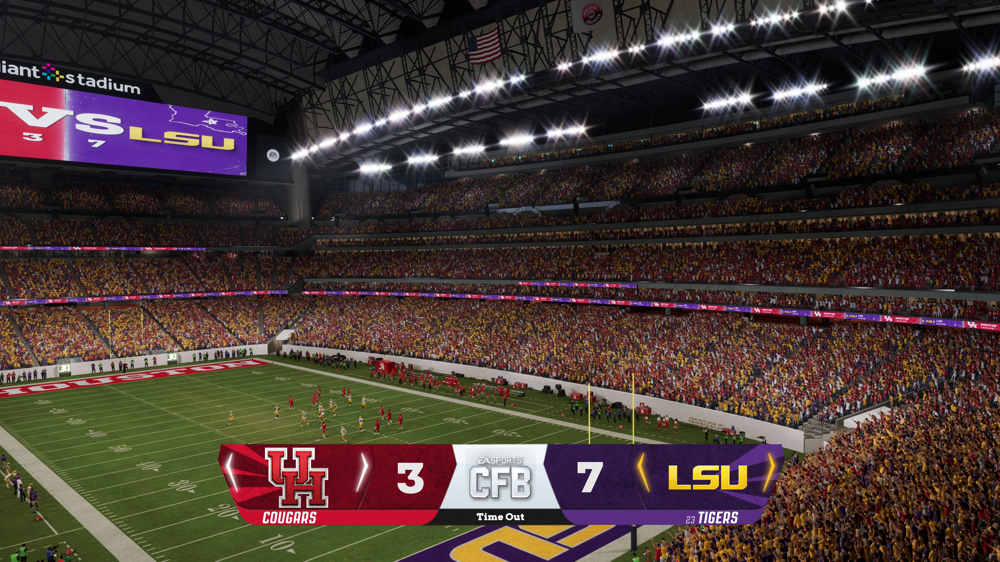

# Ace’s Gameday Atmosphere

## Read the stands at kickoff

Open **Dynasty Central > User Settings > Gameday Atmosphere**, or **Pause > Options > Settings** and move to the far right after Auto-Subs. The menus group the controls under **Attendance**, **Soundscape** and **Broadcast**. **Dynamic Attendance** starts on. Most choices take effect during play or at the next suitable break. Choose the crowd plan settings before launching a game.

| What you're looking at | What it measures |
| --- | --- |
| Game attendance | The game's own figure for this matchup. Certain games, including supported neutral-site games, keep that turnout. |
| Expected turnout | How many supporters the mod expects after considering available program and matchup information. |
| Occupied seats | Who is seated now in the part of the stadium the game has made available. Arrivals, breaks and departures can change it. |
| Pause-menu fullness | Open Pause and look beside Resume. A dash means the seat reading is still unavailable. The display starts on. |

## Read the colors in the stands



### Why two games can look different

A strong opponent or rivalry can bring more people out. Poor seasons can empty seats, even at a large stadium. Program demand, recent results, venue, weather and kickoff context all have a part when known. A large capacity alone cannot create fans. The game also controls which seats it draws on screen.

> At a 50,000-seat stadium, suppose 30,000 people are expected. If 55% of them are seated at kickoff, that's 16,500 fans. As others arrive, the visible crowd can grow without changing how many people were expected for the day.

## Follow the crowd through the game

In **Attendance**, the starting **Attendance Profile** is **Default**. **Fuller Crowds** brings more people in at kickoff and can lift turnout in new regular-season Dynasty games. **Fans Arriving After Kickoff** starts on. Switching it off seats the expected crowd at kickoff. A small matchup can still have plenty of empty seats.

| Attendance control | Factory choice and range |
| --- | --- |
| Ordinary Kickoff Crowd | 55% of expected fans, adjustable from 50-60%. |
| Late-Arriving Schools: Kickoff | 45%, adjustable from 40-50%. Weather and night games can affect the result. |
| Big Game Kickoff Bonus | 3 percentage points for qualifying games, adjustable from 0-3. |
| When Arrivals Finish | Halfway through the first quarter (50%). Choose 10-100% of Q1. |
| Fans Leaving Early | 100% strength. Choose 0-200%. At zero, score-and-time pressure from this control stops. |
| Halftime Seat Breaks | 100% strength. Choose 0-200%. Those taking a temporary break can return early in Q3. |

**Fan Patience** starts at **Automatic**. **Normal**, **Patient Fans** and **Bad Weather** change how quickly fans leave, while kickoff turnout follows its own rules. **Beat the Traffic** starts on and lets people head home sooner during a late home blowout. Some winning visitors can leave too. Watching a replay does not advance the crowd's movement.

> A break and a departure look similar at first. A fan who leaves the seat for halftime can come back. Someone who has gone home stays gone.

## Find the visitors

**Visiting Fans** starts on. On a newly planned home date, visiting demand draws on a program's national following, local interest and the trip to the game. Home demand affects how many seats are available to those visitors. When city locations are missing the model can use a broader regional estimate. If geography is unknown, it avoids assuming a long or easy trip.

### Look beyond one block

The visitor plan targets a supporter count. A visiting-heavy core can span nearby seating blocks separated by aisles. Each block grows along its own seats. You can still see mixed edges and home pockets. Elsewhere, visitors sit in parties of one to eight, weighted toward two to four. Recognized bands and protected groups retain their own treatment. Native empty seats stay empty.

**Visiting Fan Strength** starts at **100%**. Adjust it from **0-200%** for a new home-date plan. Zero uses the model's minimum visiting presence. Ordinary eligible plans generally begin in the 3-35% range, with stronger shares reserved for qualifying matchups. Supported neutral-site games use their own split, bounded between 30% and 70% per side.

### Revisit a saved matchup

A saved fixture normally reuses its existing crowd, including older single-block plans. To see the new seating plan, launch a fixture that has no saved plan. To intentionally replace the next plan, turn on **Regenerate Next Crowd** before newly starting that Dynasty game. The switch turns itself off. It defaults off. Reloading a game in progress does not request regeneration. Rebuilding from the same inputs can give the same result.

> The new seating layout still needs a stadium-by-stadium visual check. Compare the core and nearby blocks on a fresh plan, then return to the same matchup and check that the layout holds.

```seats
HHHVVVVVH  VVHVHHHHH
HHVVVVVVV  VVVVVHHHH
HHHVVHVVV  VVHVVHHHH
HHHHVVHVV  VVVHHHVVH
HHHHHHVHH  VHHHHHVHH
```

## Home noise and visiting cheers

**Crowd Sound Effects** starts on. Restart MMC and the game after changing this master switch. **Extra Crowd Energy**, **Opening Atmosphere**, **Play Selection Atmosphere**, **Overtime Atmosphere** and **Upset Watch Sounds** also start on. They add energy in their named situations when the crowd and game qualify.

### What the 20% threshold counts

At an ordinary home stadium, an added positive visiting cheer needs visiting supporters to make up at least one fifth of the modeled spectators **currently present**. Temporary breaks, late arrivals and permanent departures affect the count. Bands are excluded. Protected spectators are counted on their assigned side when the game supplies a verified count. If the crowd has settled, the mod can check that the same match, seats and absences still apply and keep using the verified count. If it cannot confirm that count within three seconds, or cannot match it to this game, it skips the added cheer. Neutral-site reactions keep their shared-crowd behavior. Later crowd movement cannot bring back a skipped cheer.

| Visitors among 10,000 present | What can happen |
| --- | --- |
| 1,999 (19.99%) | The mod skips the visiting cheer and its added follow-ups. |
| 2,000 (20.00%) | An eligible visiting play can trigger an added cheer. |
| 2,001 (20.01%) | The same eligibility applies. Timing and the play still matter. |

A visiting touchdown can still quiet the home background below 20%. Home disappointment sounds, camera effects, bands, commentary and the game's own presentation have separate rules. The game mixes some native reactions together, so you may hear its own cheers regardless of the threshold.

> In the controlled LSU-Ole Miss game on build 2.1.36, the player heard the home background get clearly quieter after the visiting score. Its background channels reached about -7.6 dB. A paused status screen had obscured that evidence. Other fixtures and mixes need their own listening check.

## Tune the broadcast

**Live Play Reactions**, **Skill Move and Big Hit Reactions**, **Buildup During Passes**, **Cheers and Disappointment** and **Major Celebrations** start on in Soundscape. Pass buildup needs Live Play Reactions. Adjust **Crowd Volume Adjustment** from 0-100% (default 100) to choose how far sound follows the seated crowd. A long score alone does not guarantee a major celebration.

| Broadcast control | Starting choice |
| --- | --- |
| Added Camera Shake / Away Team Reaction Shake | Both on. Also enable the game's Dynamic Camera Effects for added shake. Turning off visitor shake keeps eligible sounds. |
| Normal / Important Down shake | 5% / 10%, each adjustable from 0-100%. |
| Live Play / Touchdown / Major Celebration shake | 11% (0-30%), 16% (0-100%) and 22.5% (0-100%). |
| Cannon / Neutral-Site shake | 18% (0-30%) and 75% (0-100%). Cannon sound can remain at zero shake. |
| Camera-specific shake | Standard, Zoom, All-22, Wide and Broadcast each start at 100% and allow 0-200%. Wide Player Camera Compensation starts off. |

### Choose replay types

**Additional Replays**, **Full-Screen Big Play Replays**, **Small Replays During Play Selection** and **Defensive Play Replays** start on. The full-screen gain threshold starts at **12 yards**, adjustable from **10-60**. The game must have a suitable clip. Slow Sim lacks the play-selection window for small insets. A supported Broadcast Universe setup can receive a big-play request. Touchdown replay selection belongs to the game.

> If shake feels strong only in Broadcast view, lower that camera's percentage. Keep the other camera sliders where you like them.

## Spring, neutral sites and Play Now

### A scrimmage for one school

In a supported Dynasty Extensions spring game, the crowd represents the actual school, including supported TeamBuilder identities. The practice stand-in supplies an opponent on the field. It has no separate visiting fanbase. Ordinary fans wear the school's colors and protected groups retain their own appearance.

Exhibition turnout uses the school's audience, venue and available time, weather and roof information. It has a 60% ceiling. Some fans take a break, others leave permanently after halftime and the crowd can thin further as the second half moves on. The spring score does not trigger those departures. A disappointing series by the starting offense can qualify for a restrained reaction. Hearing spring boos consistently still needs a listening test.

### A neutral or postseason date

Supported neutral Dynasty fixtures, including verified championship launches, retain the game's turnout. Each school can have a substantial section. Their fanbases and prestige help set the split. Neutral crowd distribution and shake have separate rules from an ordinary visitor section.

### A quick game or an empty stadium

In basic offline Play Now, fresh games with arrivals on start at 75% of the available crowd and then fill. Visiting colors follow the game's own seating. Dynasty travel and saved matchup plans belong to Dynasty. Online matches and ordinary practice are outside this module's live atmosphere scope.

**2020 Mode** starts off. Turn it on for empty stands and quieter stadium sound. It mutes the collective crowd, bands, drums and PA. Some voices and field sounds may remain.

## Getting help

### 1. Tell us what happened

Write **Ace’s Gameday Atmosphere 2.1.38**, the game mode and what you tried. Say what you expected and what happened instead.

### 2. Show the screen

Take a screenshot of the stands or pause screen, with the teams, quarter and score visible. For a sound issue, say what you heard and when.

### 3. Send the matching log

Press **Win+R**, paste **%LOCALAPPDATA%\Ace\DynastyCOT\GamedayAtmosphere** and press **Enter**. Open **Logs**. Send **launcher.log** if the mod did not start. For a crowd or sound issue, send **status.txt** and **DynamicGamedayAtmosphere.log** from that game.

> If the folder or log is missing, say which one you could not find. Send the screenshot anyway.
